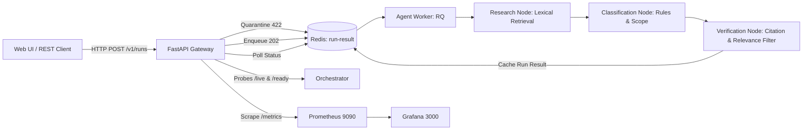

# Export Classification Check Service (Mini Project 07)

An evidence-first, asynchronous REST advisory service for proposed export tariff classification.

> [!IMPORTANT]
> **Legal Disclaimer:** This service provides decision support only. It does **not** file customs declarations, calculate duties, or replace a licensed customs broker. The system enforces a **strict fail-closed policy**: if official evidence is absent, competing, or unverified, it escalates to human specialist review rather than guessing an HS code.

---

## 1. System Architecture

The application is decomposed into five decoupled containers orchestrated via Docker Compose:



### Component Roles & Isolation
- **API Gateway (`app.main`)**: FastAPI web server handling Pydantic contract validation, rate limiting (10 req/min/IP), deterministic prompt-injection guardrails, and idempotent request deduplication (`X-Idempotency-Key`).
- **Broker & Data Store (`redis:7-alpine`)**: Separates request submission from execution, maintains the `classification` queue, caches run results (`run-result:{run_id}`), and tracks public-to-job ID mappings (`run-job:{run_id}`).
- **Agent Worker (`app.worker` + `app.core`)**: Python process executing bounded LangGraph state graphs with query expansion and citation verification.
- **Monitoring (`monitoring/`)**: The API `/metrics` endpoint exposes verification counters shared by the API and RQ workers through Redis. Prometheus and Grafana are optional Compose services; the API scrape itself requires Redis to be reachable.

---

## 2. Quick Start & Prerequisites

### Prerequisites
- Docker Desktop with Compose v2
- Python 3.11+ / PowerShell (for local tooling and test suites)

### Startup Commands
1. Copy configuration file:
   ```powershell
   Copy-Item .env.example .env
   ```
2. Build and start services:
   ```powershell
   docker compose up --build -d
   ```
3. Verify running services:
   ```powershell
   docker compose ps
   ```

### Port Conflict Handling (e.g., Host Port 8000 Occupied)
If port 8000 is occupied by an unrelated host application:
```powershell
docker compose run -d -p 8001:8000 --name exportclassification-api-live api
$env:API_BASE_URL = "http://localhost:8001"
```

---

## 3. REST API Contract & Endpoints

| Endpoint | Method | Status | Purpose |
|---|---|---|---|
| `/live` | `GET` | `200` | Process liveness probe. |
| `/ready` | `GET` | `200` / `503` | Readiness probe verifying Redis, queue depth, and worker count. |
| `/health` | `GET` | `200` | Backward-compatible health check (`status: ok \| degraded`). |
| `/metrics` | `GET` | `200` | Prometheus metrics scrape target. |
| `/v1/runs` | `POST` | `202` | Submits a classification request. Returns `run_id` and `status_url`. |
| `/v1/runs/{run_id}` | `GET` | `200` / `404` | Polls run status (`queued`, `started`, `completed`, `failed`). |
| `/v1/quarantine/summary` | `GET` | `200` | Audits requests rejected by input guardrails. |
| `/v1/feedback` | `POST` | `200` | Submits human analyst feedback on classification outputs. |

### Submitting a Request (PowerShell)
```powershell
$headers = @{
  "Content-Type" = "application/json"
  "X-Idempotency-Key" = "shipment-box-001"
}
$body = @{
  description = "Stainless steel vacuum flask with a moulded plastic outer body"
  materials = @("stainless steel", "plastic")
  intended_use = "Reusable beverage container"
  country_of_export = "India"
  destination_country = "United States"
  client_id = "demo"
} | ConvertTo-Json

$job = Invoke-RestMethod -Method Post -Uri "http://localhost:8001/v1/runs" -Headers $headers -Body $body
$job

# Poll for terminal result
Start-Sleep -Seconds 2
Invoke-RestMethod -Uri ("http://localhost:8001" + $job.status_url)
```

---

## 4. Evaluation Methodology & Reproducible Quality Metrics

The evaluation suite tests 20 fixed scenarios (`evals/scenarios.json`) representing complex customs classification challenges.

### Scientific Integrity Principles
- **Route Match is NOT Legal Correctness:** A 100% route match indicates that test policy routing succeeded (escalating to specialist or asking for clarification). It does **not** prove legal tariff accuracy.
- **Separation of Evaluation Tiers:**
  1. *Preliminary Lexical Overlap (Automated):* Filters out weak material-only matches.
  2. *Semantic Claim Entailment (Manual):* Verifies whether cited excerpts logically prove each claim in the rationale.
  3. *Statutory Legal Correctness (Specialist):* Verifies compliance with statutory GRI and official customs notes.
- **Zero Fabrication:** Groundedness, Faithfulness, and Hallucination rates are never fabricated. When manual annotations are pending, they are reported as **PENDING**.

### Run Batch Evaluation & Reporting
```powershell
# Run the batch evaluation against the live service
$env:API_BASE_URL = "http://localhost:8001"
.venv\Scripts\python.exe evals/run_batch.py

# Generate evaluation summary and baseline comparison
.venv\Scripts\python.exe evals/evaluate_results.py --results evals/latest_results.json --baseline evals/baseline_before_verification.json --annotations evals/manual_annotations_template.json
```

---

## 5. Performance and Load Testing

Performance testing is fully reproducible using `benchmarks/run_load_test.py`:

```powershell
.venv\Scripts\python.exe benchmarks/run_load_test.py --url http://localhost:8001
```

### Latest Saved Benchmark Results
`benchmarks/load_test_results.json` was recorded at 2026-10-12 19:03 UTC against `http://localhost:8001`. The workload was bounded and small: 20 health requests at each of concurrency 1 and 3; six submissions at concurrency 2; then a 61-second cooldown followed by three E2E jobs at concurrency 1 and four at concurrency 2.

| Workload | Concurrency | Requests/jobs | Throughput | Median | p95 | Errors |
|---|---:|---:|---:|---:|---:|---:|
| GET `/health` | 1 | 20 | 82.52 req/s | 7.63 ms | 29.82 ms | 0 |
| GET `/health` | 3 | 20 | 230.19 req/s | 9.07 ms | 23.28 ms | 0 |
| POST `/v1/runs` | 2 | 6 | 94.26 req/s | 20.02 ms | 34.36 ms | 0 |
| Async E2E | 1 | 3 | 0.93 jobs/s | 1.051 s | 1.060 s | 0 |
| Async E2E | 2 | 4 | 0.95 jobs/s | 1.568 s | 2.605 s | 0 |

E2E worker median/queue-wait median were 0.8243/0.203 s at concurrency 1 and 0.8254/0.728 s at concurrency 2. The artifact retains earlier E2E measurements under `previous_e2e_benchmark` and `previous_e2e_benchmark_history`. Samples are small and are not a production capacity guarantee.

---

## 6. Automated Test Suite

Run the full automated test suite (including worker-metric aggregation coverage):

```powershell
.venv\Scripts\python.exe -m pytest -v
```

### Test Coverage Breakdown
- `test_contract.py`: Pydantic schema validation, country cross-checks, bounds.
- `test_guardrails.py`: Input prompt-injection detection and threat quarantine.
- `test_run_status.py`: Public run ID resolution, Redis caching, RQ enum translation.
- `test_evidence_verification.py`: Fail-closed verification, citation resolution, lexical filter.
- `test_evaluation_quality.py`: Metric aggregation, missing field handling, annotation schema validation.
- `test_performance.py`: Benchmark latency calculations, rate-limit metric tracking.
- `test_reliability.py`: Redis failure handling, worker exceptions, 422 quarantine, `/live` and `/ready` probes.

---

## 7. Known Limitations & Next Steps

1. **Official Tariff Corpus**: The bundled `corpus/` contains starter text. Official CBIC/DGFT schedules must be imported before commercial deployment.
2. **Dense Retrieval (Chroma / FAISS)**: Current retrieval uses lexical keyword overlap. A dense vector index with domain embeddings would improve semantic recall.
3. **External LLM Integration**: The current agent topology is deterministic rule-based. Connecting external LLMs will require circuit breakers, backoff retry policies, and token cost accounting.
4. **Distributed Rate Limiting**: The in-memory sliding window should be backed by Redis sorted sets in clustered multi-instance deployments.
