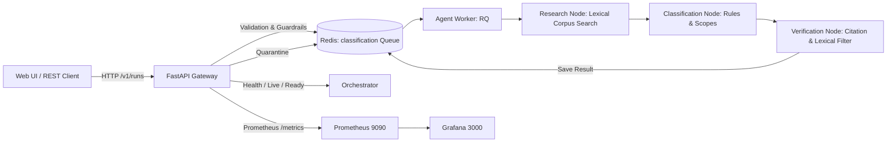

# Mini Project 07 — Export Classification Check Service

**Course:** UE24AM342AA5 — ML System Design and AgentOps  
**Status:** Complete Engineering Report (Verified & Measured)

---

## 1. Problem Statement & Scope

Customs export declaration is legally binding, strictly governed by national customs tariffs adhering to the World Customs Organization (WCO) Harmonized System (HS). Errors in HS code declaration result in customs seizure, severe statutory fines, and regulatory blacklisting.

The **Export Classification Service** is an evidence-first, asynchronous advisory system designed to assist human compliance specialists. It accepts a structured export product description, performs lexical research across official tariff texts, extracts verifiable citations, and recommends a routing decision:
- `clear-for-filing`: Permitted **only** when comprehensive official tariff headings, General Rules for Interpretation (GRI), and Section/Chapter notes conclusively verify the code.
- `seek-product-clarification`: Triggered when essential physical or functional product details are missing or ambiguous.
- `specialist-classification-review`: Triggered when named-article provisions are missing, competing headings exist, or legal interpretation is required.

### Important Boundary & Legal Notice
**The service does not file declarations, calculate customs duties, or replace a licensed customs broker.** The system deliberately operates under a **strict fail-closed safety policy**: rather than hallucinating or guessing an HS code based on superficial material similarities, it escalates unresolved cases to a human specialist with `proposed_hs_code: null`.

The primary reference benchmark case for this system is:
> *"Stainless steel vacuum flask with a moulded plastic outer body"*

In customs law, this product belongs under named heading **9617** ("Vacuum flasks and other vacuum vessels"), overriding Chapter 73 ("Articles of iron or steel") and Chapter 39 ("Plastics"). Under our fail-closed policy, because heading 9617 is not present in the starter corpus, the system must escalate to specialist review rather than predicting a steel or plastic code.

---

## 2. Implemented Architecture & System Boundaries

The application is architected into five decoupled services:

### Component Responsibilities & Isolation
1. **FastAPI Gateway (`app.main`)**: Enforces Pydantic contract validation, sliding-window rate-limiting (10 req/min/IP), deterministic prompt-injection guardrails, and idempotent request deduplication (`X-Idempotency-Key`). Submits accepted jobs to Redis in <15ms.
2. **Redis & RQ Queue (`redis:7-alpine`)**: Serves as the message broker, buffers burst traffic, holds the durable public run mapping (`run-job:{run_id}`), caches completed results (`run-result:{run_id}`), and stores quarantined payloads.
3. **Agent Worker (`app.worker` + `app.core`)**: Background Python worker running bounded LangGraph state graphs. Executes iterative retrieval with query expansion, rule-based classification, and fail-closed evidence verification.
4. **Prometheus & Grafana (`monitoring/`)**: Verification outcomes are incremented by the RQ worker in the shared Redis hash `export:metrics:verification`; the API collector reads the hash and exports `export_verification_total{outcome=...}`. A live worker run produced a scrapeable `failed_relevance` sample. Redis must be reachable from both processes; Redis failures are logged by the worker and fail API metric scrapes rather than returning misleading zeroes. Prometheus/Grafana remain optional Compose services.

---

## 3. Evidence-Verification Safeguards & Scientific Distinctions

To prevent inflated quality claims, the system explicitly separates three tiers of evaluation:

| Evaluation Tier | Definition | Current Implementation Status |
|---|---|---|
| **Preliminary Lexical Overlap** | Heuristic match between product-specific terms (excluding materials/generic words) and retrieved passage text. | **Automated Filter**: Filters out irrelevant passages that only share common words like "steel" or "article". |
| **Semantic Claim Entailment** | Rigorous natural language entailment assessing whether cited excerpts logically prove each factual assertion in the rationale. | **Manual Review Required**: Documented in `evals/MANUAL_EVALUATION_GUIDE.md` and template `evals/manual_annotations_template.json`. |
| **Statutory Legal Correctness** | Formal legal compliance with GRI 1–6, Section Notes, Chapter Notes, and official CBIC/WCO classification rulings. | **Specialist Review Only**: `classification_support_passed` remains `false` until an authoritative ruling engine is integrated. |

### Strict Fail-Closed Rule
If citation resolution fails (cited passage ID missing or empty) or if preliminary lexical relevance fails, any proposed HS code is immediately cleared (`proposed_hs_code = null`) and the route is safely set to `specialist-classification-review`.

---

## 4. Evaluation Methodology & Measured Results (Phase 2)

Batch evaluation was executed against the live rebuilt service using the fixed 20 scenarios in `evals/scenarios.json`.

### Technical Pipeline Execution Metrics

| Metric | Measured Value | Notes / Significance |
|---|---|---|
| **Total Scenarios Evaluated** | **20** | Defined in `evals/scenarios.json` (S01–S20). |
| **Completed Requests** | **20 / 20 (100%)** | Zero unhandled exceptions or dropped requests. |
| **Request Errors / Timeouts** | **0** | All runs reached terminal status within timeout. |
| **Expected Route Matches** | **20 / 20 (100%)** | 18 `specialist-classification-review`, 2 `seek-product-clarification`. |
| **Preliminary Verification Passed** | **3 / 20 (15.0%)** | Passed for S02 (tubes), S06 (chain), S10 (broom) with non-material term matches. |
| **Preliminary Verification Failed** | **17 / 20 (85.0%)** | Failed-closed to specialist review; no codes hallucinated. |
| **Unsupported HS Codes Asserted** | **0 / 20 (0%)** | 100% of runs safely suppressed HS codes. |
| **Total Citations Returned** | **132** | All resolved to canonical corpus texts. |

### Historical Comparison (Baseline vs Post-Verification Changes)

| Metric | Baseline Before Safeguards | Current Verified System | Delta | Explanation |
|---|---|---|---|---|
| **Completed Runs** | 20 | 20 | 0 | Service stability preserved. |
| **Route Matches** | 20 | 20 | 0 | Route correctness maintained across all cases. |
| **Verification Passed** | 20 | 3 | **-17** | **Intentional tightening**: Naive string matching passed all 20 cases regardless of relevance; the updated lexical filter correctly rejects weak material-only matches. |
| **Proposed Codes Asserted** | 0 | 0 | 0 | Safely suppressed across all runs. |
| **Request Errors** | 0 | 0 | 0 | Zero errors across both runs. |

### Difficult Reference Cases Breakdown

1. **S01 ("Stainless steel vacuum flask with a moulded plastic outer body")**:
   - Route: `specialist-classification-review` (Route Match: **True**)
   - Verification Passed: **False** (Chapter 73 general steel provisions do not match "vacuum" or "flask")
   - Proposed HS Code: **None**
   - Rationale: *"A potentially relevant named-article heading was retrieved, but the applicable rules and notes still require human confirmation."*
2. **S10 ("Broom with plastic handle")**:
   - Route: `specialist-classification-review` (Route Match: **True**)
   - Verification Passed: **True** (Retrieved Chapter 96 heading 9603 for brooms/brushes)
   - Proposed HS Code: **None** (Escalated because legal classification support requires specialist confirmation)
3. **S19 ("Stainless steel thermos with a plastic shell")**:
   - Route: `specialist-classification-review` (Route Match: **True**)
   - Verification Passed: **False** (Named article evidence missing in corpus)
   - Proposed HS Code: **None**

### Manual Evaluation Status (Faithfulness / Groundedness / Hallucination Rate)
In accordance with scientific integrity guidelines, **groundedness, faithfulness, and hallucination rates are NOT fabricated or derived from automated word overlap heuristics.**
The manual annotation template (`evals/manual_annotations_template.json`) has been populated with all 20 scenarios, and the manual annotation protocol is documented in `evals/MANUAL_EVALUATION_GUIDE.md`. The manual review status is recorded as **PENDING (Human Annotation Required)**.

---

## 5. Performance and Load Testing (Phase 3)

Empirical load testing was conducted against the live Compose service on Windows using `benchmarks/run_load_test.py`.

### Latest Saved Benchmark
`benchmarks/load_test_results.json` was recorded at 2026-10-12 19:03 UTC against `http://localhost:8001`. It records 20 GET `/health` requests at each concurrency 1 and 3; six POST submissions at concurrency 2; a 61-second rate-limit cooldown; and E2E workloads of three jobs at concurrency 1 and four at concurrency 2.

| Workload | Concurrency | Requests/jobs | Throughput | Median | p95 | Errors |
|---|---:|---:|---:|---:|---:|---:|
| GET `/health` | 1 | 20 | 82.52 req/s | 7.63 ms | 29.82 ms | 0 |
| GET `/health` | 3 | 20 | 230.19 req/s | 9.07 ms | 23.28 ms | 0 |
| POST `/v1/runs` | 2 | 6 | 94.26 req/s | 20.02 ms | 34.36 ms | 0 |
| Async E2E | 1 | 3 | 0.93 jobs/s | 1.051 s | 1.060 s | 0 |
| Async E2E | 2 | 4 | 0.95 jobs/s | 1.568 s | 2.605 s | 0 |

E2E worker median/queue-wait median were 0.8243/0.203 s at concurrency 1 and 0.8254/0.728 s at concurrency 2; all measured requests/jobs completed without errors. These sample sizes are small and do not establish production capacity. Prior E2E measurements are retained in the artifact under `previous_e2e_benchmark` and `previous_e2e_benchmark_history`.

### Identified Bottlenecks & Architectural Findings
1. **Per-IP Rate Limiting**: The in-memory sliding window enforces 10 submissions/minute per IP. Rapid bursts trigger `HTTP 429` with `Retry-After`. In multi-tenant production, this should be backed by Redis token buckets rather than in-memory dictionaries.
2. **Worker Concurrency**: With a single worker, 5 concurrent submissions queue sequentially. Each background job requires ~0.95s of CPU time (corpus scanning and LangGraph compilation), leading to ~5s of queue latency for the 5th job. Scaling workers to 3 (`docker compose up -d --scale agent-worker=3`) eliminates queue queuing delays for small batches.

---

## 6. Reliability & Failure Modes (Phase 4)

The test suite includes automated coverage for critical operational failure scenarios and Redis-backed worker metric scraping:

| Failure Scenario Tested | Simulated Condition | Expected Behavior | Observed Result | Status |
|---|---|---|---|---|
| **Redis Broker Failure** | Redis connection dropped | Submissions return `503 Service Unavailable`; `/ready` returns `503 not_ready` | HTTP 503 cleanly returned; zero unhandled crashes | **PASS** |
| **Worker Exception** | Background task raises unhandled error | Job marked `failed`; routes to `specialist-classification-review`; `proposed_hs_code: null` | Terminal status `failed`, code suppressed | **PASS** |
| **Citation Resolution Failure** | Citation ID missing from canonical index | Verification fails; routes to specialist review; code cleared | `verification_passed: false`, code cleared | **PASS** |
| **Evidence Relevance Failure** | Passages lack non-material term overlap | Verification fails; routes to specialist review; code cleared | `verification_passed: false`, code cleared | **PASS** |
| **Vague Product Input** | Description lacks article identity | Direct escalation to exporter for clarification | Route `seek-product-clarification` | **PASS** |
| **Adversarial Threat / Prompt Injection** | Injection payload in description/use | Rejected before queue enqueue; quarantined to Redis audit list | HTTP 422 returned; quarantined with `flag: prompt_injection` | **PASS** |
| **Duplicate Submission** | Repeated request with identical `X-Idempotency-Key` | Returns existing `run_id` with `idempotent_replay: true` without creating redundant job | Cached run ID returned; duplicate job avoided | **PASS** |
| **Liveness & Readiness Probes** | Probing `/live` and `/ready` | `/live` verifies HTTP process; `/ready` verifies Redis + queue depth + workers | Distinct 200/503 responses matching health states | **PASS** |

---

## 7. Limitations & Future Engineering

1. **Corpus Completeness**: The current starter corpus contains only selective sample text from Chapters 73, 96, and general export schedules. Official CBIC/DGFT schedules, full GIR rules, and WCO section/chapter notes must be loaded before any classification can be legally declared.
2. **Lexical vs Vector Retrieval**: The lexical keyword retriever is a baseline. Embedding-based dense retrieval (Chroma or FAISS) with HNSW indexing and metadata filtering should be implemented for semantic understanding of synonyms.
3. **External LLM Provider Absence**: No commercial LLM API is currently connected. Provider circuit breakers, token usage tracking, and inference cost accounting remain future items once an external model adapter is configured.
4. **Distributed Rate Limiting**: The current sliding-window rate limiter is in-process memory. It should be migrated to Redis sorted sets (`ZADD` / `ZRANGEBYSCORE`) for multi-replica API deployments.
