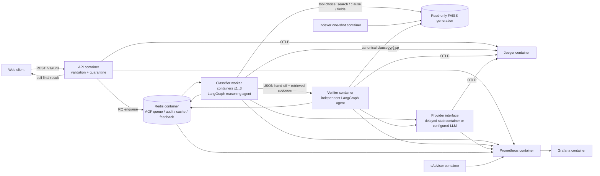

# Design and deployment boundaries

The API never executes agents in its request thread. RQ persists jobs between
submission and worker execution. Polling supports long runs, avoids callback
SSRF, and does not require a publicly reachable caller. Scaling the classifier
workers requires no fixed worker ports or container_name. Verification is an
independently deployed process, not another prompt in the same process. Its
canonical corpus resolves each citation and rejects tampering or missing evidence.
The provider is a separate boundary for realistic delay/failure testing and
replacement by an OpenAI-compatible model. Indexing releases immutable generations;
workers load the current manifest for each new run, and old citations remain in
run audit records. Redis is a single-node persistence and contention boundary.

Classifier decisions: inspect request fields; material-oriented search; read
section/chapter notes; derive article-name query from those notes and the
identified article; exact clause lookup; propose; hand off for independent
verification. If verification fails, exact heading/notes/policy retrieval runs
once more; another rejection escalates with no classification. The planner is a
bounded deterministic LangGraph agent, with a model proposal at its decision
boundary. Its tool choices depend on state, not on arbitrary product instructions.
It is not a general-purpose autonomous LLM tool caller.

The three tools are corpus_search (LangChain BaseRetriever + FAISS plus lexical
article boost), clause_lookup, and request_fields. Limits: 20 decision steps,
14 tool calls, 45s RQ hard execution deadline, 5s HTTP provider timeout, bounded
retries with 150ms/300ms exponential backoff. The verifier handoff is bounded by
15s. A provider failure is shared by all replicas through Redis breaker state.
If verifier dies mid-run, the classifier issues a specialist escalation. If the
classifier dies, RQ marks the job failed; status polling exposes escalation.
No unverified proposal is returned as a successful recommendation.

# Corpus and embedding decisions

Focused clauses keep each heading with its subordinate text and each applicable
note together. Page-aligned background chunks use a maximum 4,500 characters;
focused legal notes may exceed it to preserve exclusions. IDs, one-based physical
PDF page, exact extracted text, source filename and SHA256 travel together.
The bundled CBIC 2022 authored document was obtained from a clearly labelled
mirror; the DGFT snapshot was obtained directly. WCO GRI substitutes for the
unavailable CBIC-hosted rules. These are documented deviations pending corpus
confirmation, not claims of current law.

Local word and character-trigram hash embeddings (768 dimensions) are deterministic,
free, model-free and indexable through LangChain Embeddings/FAISS. They trade semantic
paraphrase recall for a tiny image and reproducible offline startup. The explicit
article search and lexical boost matter more than embedding rank for the reference
case. A sentence-transformer model was rejected as a default because downloading
weights would make clean startup dependent on an extra host; it remains a sensible
future improvement. Unknown synonyms escalate. This is not MiniLM or a trained
semantic embedding. Embeddings cache by text hash plus algorithm version; unchanged
clauses reuse vectors when any other source changes. `--reembed` forces refresh;
index generations publish via an atomic manifest replacement. There is one indexer
writer. Rebuilding FAISS is cheap here; re-embedding the unchanged corpus is avoided.

# Threat boundaries and scope

All free text that can reach the model is NFKC-normalised and screened for injection
and toxicity. The model receives structured untrusted product/passages; it has no
network, shell, credential or filing tools. A finite output schema and independent
canonical verification prevent arbitrary model prose from authorising shipment.
Regex guardrails are a baseline, not comprehensive multilingual injection/toxicity
coverage. Corpus is bundled and operator-controlled. A genuine legal classifier
would need wider notes, a larger multilingual article recogniser and specialist
review of every inference. This project intentionally limits article coverage and
never invents a fallback tariff heading.
